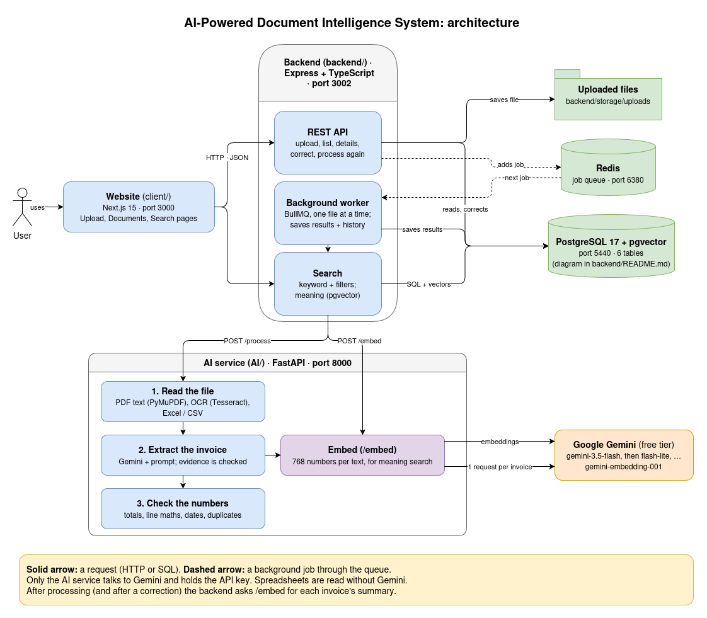

# AI-Powered Document Intelligence System

Upload invoices as **PDF, scanned PDF, image (JPG, PNG, TIFF), Excel (XLSX, XLS) or CSV**. The system reads them
(with OCR for scans and photos), extracts the invoice details with an AI model, checks the numbers, and lets you
review, correct and search them in a website.

- **Extracts** invoice number, date, supplier, customer, subtotal, tax, total, currency and line items. Every value
  comes with its **evidence** (the words in the document it was read from), and a value that isn't in the document
  stays **empty**, never guessed.
- **Checks** each invoice: missing fields, totals that don't add up, wrong line maths, odd dates, duplicates. Invoices
  with a problem are marked **needs review**.
- **Processes in the background**, so uploading many files never blocks the website.
- **Searches** by keyword, with filters (date, amount, currency, supplier), and by **meaning** ("office furniture" finds "chairs").
- **Measured:** 95.4% of fields right on a labeled test set, 100% of valid documents processed, 0 made-up values
  ([evaluation report](deliverables/EVALUATION_REPORT.md)).

## How it fits together

```
 Website (client/)  ──►  Backend API (backend/)  ──►  AI service (AI/)  ──►  Google Gemini
 Next.js, port 3000      Express, port 3002            FastAPI, port 8000     (free tier)
                           │        │                   OCR (Tesseract),
                           ▼        ▼                   Excel/CSV reading,
                     PostgreSQL   Redis                 checks
                     + pgvector   (job queue)
                     port 5440    port 6380
```




The website only talks to the backend. The backend saves everything in PostgreSQL and puts each upload in a
job queue (Redis); a background worker sends the file to the AI service and saves the result. Only the AI
service talks to Gemini, and only it holds the API key.

| Folder | What it is | Built with |
|---|---|---|
| [`client/`](client/README.md) | The website | Next.js 15, React 19, TypeScript, Tailwind CSS 4, shadcn/ui |
| [`backend/`](backend/README.md) | The REST API, background jobs, database and search | Node.js, Express 4, TypeScript, PostgreSQL 17 + pgvector, Redis + BullMQ |
| [`AI/`](AI/README.md) | Reads files and extracts the invoice data | Python 3.12, FastAPI, PyMuPDF, Tesseract OCR, openpyxl, Google Gemini |
| [`deliverables/`](deliverables/README.md) | Every deliverable of the assignment: diagrams, database schema, test results, evaluation report, AI-use note | Markdown, plain text |

## What you need

| Tool | Version | Install |
|---|---|---|
| Docker (with Docker Compose) | any recent | https://docs.docker.com/get-docker/ |
| Node.js | 20 or newer (tested with 24) | https://nodejs.org |
| uv (Python manager; it installs Python 3.12 for you) | any recent | `curl -LsSf https://astral.sh/uv/install.sh \| sh` |
| Tesseract OCR | 5 | Ubuntu/Debian: `sudo apt install tesseract-ocr` · macOS: `brew install tesseract` |
| A Google Gemini API key | free | https://aistudio.google.com → "Get API key" |

## Setup

Tested on Linux (Ubuntu). macOS should work the same way; on Windows, use WSL.

**1. Get the code**

```bash
git clone https://github.com/abdulalimrakib/AI-Powered-Document-Intelligence-System.git
cd AI-Powered-Document-Intelligence-System
```

**2. Start the database and the job queue** (in the project folder)

```bash
docker compose up -d
```

This starts PostgreSQL (with pgvector) on port 5440 and Redis on port 6380. The tables are created automatically
when the backend starts. Stop them later with `docker compose down` (your data is kept).

**3. The AI service** (terminal 1)

```bash
cd AI
uv sync                    # installs Python 3.12 and the packages
cp .env.example .env       # then open .env and set GEMINI_API_KEY=<your key>
uv run uvicorn main:app --reload --port 8000
```

Check: http://localhost:8000/health shows `"status": "ok"` and the Tesseract version.

**4. The backend** (terminal 2)

```bash
cd backend
npm install
cp .env.example .env       # the defaults work with the docker compose setup above
npm run dev
```

Check: http://localhost:3002/health

**5. The website** (terminal 3)

```bash
cd client
npm install
cp .env.example .env.local # NEXT_PUBLIC_API_URL=http://localhost:3002
npm run dev
```

Open **http://localhost:3000**.

### Settings

| File | Setting | Default | What it is |
|---|---|---|---|
| `AI/.env` | `GEMINI_API_KEY` | — (required) | Your Gemini key. Never put it anywhere else |
| `AI/.env` | `GEMINI_MODELS` | the free models in `AI/extract_invoice.py` | Models to use, best first; when one's daily limit is used up, the next is used |
| `AI/.env` | `GEMINI_EMBEDDING_MODEL` | `gemini-embedding-001` | The model for meaning search |
| `backend/.env` | `PORT`, `CORS_ORIGINS` | `3002`, `http://localhost:3000` | The API's port, and the website allowed to call it |
| `backend/.env` | `AI_API_URL` | `http://localhost:8000` | Where the AI service runs |
| `backend/.env` | `DATABASE_URL`, `REDIS_URL` | the docker compose ports | Database and job queue |
| `client/.env.local` | `NEXT_PUBLIC_API_URL` | `http://localhost:3002` | Where the backend runs |

The `.env` files hold secrets and are never committed (see `.gitignore`).

## Using it

1. **Upload** (http://localhost:3000/upload): drop up to 20 files at once (up to 50 MB each).
2. **Documents**: each file goes from *Waiting* to *Processing* to *Done* (or *Failed*, with the reason). The page updates by itself.
3. **Open a document** to see every invoice in it: each field with its status (found, uncertain, missing,
   corrected) and its evidence, the line items, the problems found, and the history.
4. **Correct** a wrong value with **Edit** (the invoice is checked again at once), or **Mark as checked**.
   A failed document can be **processed again**.
5. **Search** by keyword or by meaning, with filters.

No invoices at hand? The made-up sample invoices in [`AI/evaluation/dataset/`](AI/evaluation/dataset) work well
(spreadsheets are read without the AI, so they don't use Gemini requests).

The API can also be used directly; the routes are listed in [`backend/README.md`](backend/README.md#api).

## About the free Gemini tier

The free tier allows only about **20 requests a day per model**. The system uses **one request per invoice**
(spreadsheets need none), waits and tries again when Gemini is busy, and switches to the next free model when one
model's daily limit is used up. When every model's limit is used up, the invoice fails with a clear message saying
when to try again, and the document can be processed again later.

## Tests

| Part | Command | Checks |
|---|---|---|
| AI service | `cd AI && uv run pytest` | 359 |
| Backend | `cd backend && npm run typecheck && npm test` (Postgres and Redis must run) | 160 |
| Website | `cd client && npm run lint && npm run build && npm test` | 55 |

The tests use their own database, a fake Gemini, a fake AI service or a fake backend, so they never touch your
data or use Gemini requests (the few real-Gemini checks only run with `--real-gemini`).
Results: [`deliverables/TEST_RESULTS.md`](deliverables/TEST_RESULTS.md).

**Evaluation:** the system was measured on 29 made-up documents with known answers, through the real system.
Results, and how to repeat it: [`deliverables/EVALUATION_REPORT.md`](deliverables/EVALUATION_REPORT.md).

## More documentation

- [`deliverables/README.md`](deliverables/README.md): **the list of all deliverables and where each one is**
- [`AI/README.md`](AI/README.md): how files are read, the AI extraction, the checks, the evaluation tools
- [`backend/README.md`](backend/README.md): the API, background processing and search
- [`deliverables/DATABASE_SCHEMA.md`](deliverables/DATABASE_SCHEMA.md): the **database diagram**
- [`client/README.md`](client/README.md): the pages and their rules
- [`AI/extract_prompt.txt`](AI/extract_prompt.txt): the instructions given to Gemini
- [`deliverables/AI_PROMPTS_AND_AI_USE.md`](deliverables/AI_PROMPTS_AND_AI_USE.md): every AI prompt the system uses and why, how it was tested, and how AI was used to build this project
- [`deliverables/TEST_RESULTS.md`](deliverables/TEST_RESULTS.md): the test results, and what is tested

## Troubleshooting

| Problem | What to do |
|---|---|
| `port is already allocated` when starting Docker | Another program uses port 5440 or 6380. Stop it, or change the left port in `docker-compose.yml` and in `backend/.env` |
| The backend says it can't connect to the database or Redis | Run `docker compose up -d` in the project folder, and check with `docker compose ps` |
| `/health` of the AI service fails with a Tesseract error | Install Tesseract (see "What you need") and restart the AI service |
| A document fails with "GEMINI_API_KEY is missing" | Set the key in `AI/.env` and restart the AI service |
| A document fails with "the free Gemini limit is used up for today" | Wait until the time given in the message, then use **Process again** on the document |
| The website says "The backend can't be reached" | Start the backend (`cd backend && npm run dev`) and check `client/.env.local` |
