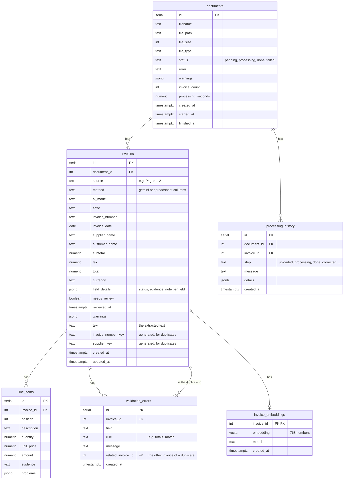

# AI-Powered Document Intelligence System — Backend

Express API for the AI-Powered Document Intelligence System.

## Run locally

The backend needs Postgres (database) and Redis (job queue). Both run in Docker. Start them once from the project root:

```bash
docker compose up -d      # Postgres on port 5440, Redis on port 6380
```

Then, in this folder:

```bash
npm install
cp .env.example .env
npm run dev
```

The server runs at http://localhost:3002. Check it with http://localhost:3002/health.

| Script | What it does |
|---|---|
| `npm run dev` | Start with auto-reload (nodemon) |
| `npm start` | Start once |
| `npm run typecheck` | TypeScript check |

## Project structure

```
app.ts                      Express app: CORS, routes, error handling
server.ts                   Starts the server on PORT
config/env.config.ts        Settings from .env.local / .env
middleware/error.handler.ts JSON 404 and error responses
lib/db.ts                   Connects to Postgres; query() and transaction()
database/schema.sql         The tables; created automatically when the server starts
routes/document.route.ts    The /api/v1/documents routes
controllers/document.controller.ts  What each document route does
lib/upload.ts               Receives uploaded files (multer) and saves them in storage/uploads/
utils/response.ts           sendResponse() for the { success, message, statusCode, data } shape
lib/queue.ts                The background queue (BullMQ + Redis) and the worker
lib/processDocument.ts      The background work for one document: AI service -> save results -> done/failed
lib/aiService.ts            Calls the AI service: POST /extract, /validate and /embed
lib/invoiceDetails.ts       Puts an invoice together for the API: fields, line items, problems
lib/duplicates.ts           Finds duplicates among all saved invoices
lib/history.ts              addHistory(): one line in a document's history
routes/invoice.route.ts     The /api/v1/invoices routes
controllers/invoice.controller.ts   Manual corrections
routes/search.route.ts      The /api/v1/search route
controllers/search.controller.ts    Keyword search and meaning search
lib/searchFilters.ts        Reads and checks the search filters (date, total, currency, supplier, needs review)
lib/embeddings.ts           Meaning search: makes and saves the embedding of each invoice and of the search words
utils/positiveNumber.ts     Reads ids and page numbers from the URL
```

## API

| Method | Path | What it does |
|---|---|---|
| POST | `/api/v1/documents` | Upload 1–20 files (form field `files`, max 50 MB each). Answers at once; each file gets the status `pending` |
| GET | `/api/v1/documents` | The list of documents, newest first. Filters: `?status=failed`, `?needs_review=true`, `?page=2`, `?limit=20` (max 100) |
| GET | `/api/v1/documents/:id` | One document: status, error, invoices (fields with status and evidence, line items, problems) and history |
| POST | `/api/v1/documents/:id/reprocess` | Try a document again: one that `failed`, or that is `done` but has invoices the AI could not read. Uses the saved file. Refused (409) while it is still pending/processing, or when nothing failed |
| PATCH | `/api/v1/invoices/:id` | Correct values: `{ "fields": { "total": "1,150.00" } }` (`""` or `null` empties a field). Mark as checked: `{ "reviewed": true }`. The values are cleaned and the invoice is checked again by the AI service (`POST /validate`); the change is saved in the history |
| GET | `/api/v1/search?q=acme` | **Keyword search** in invoice number, supplier, customer, file name, line items and the invoice text (not case-sensitive; "inv 100" also finds "INV-100"). Each result says where it was found (`found_in`) and shows the matching line or a short piece of text (`matched_text`). Exact invoice numbers first, then main fields, line items, text; then newest. `?page=` and `?limit=` (max 100) |
| GET | `/api/v1/search?q=office furniture&mode=meaning` | **Meaning search**: also finds invoices that mean the same without the same words ("office furniture" finds "Office chairs"). Closest first, each with a `similarity` from 0 to 1. Says how many invoices are not in meaning search yet (`not_in_meaning_search`). Answers 503 with a clear message when Gemini can't be used; keyword search still works then |

**Search filters** (for both kinds of search, all optional, can be combined):
`date_from`, `date_to` (e.g. `2026-01-31`, both days included), `total_min`, `total_max` (e.g. `500` or `499.99`, exact to the cent),
`currency` (e.g. `usd`), `supplier` (part of the name), `needs_review` (`true`/`false`).
Example: `/api/v1/search?q=acme&currency=USD&total_min=500&date_from=2026-01-01`.
With a filter, keyword search works without `q`: `/api/v1/search?currency=EUR` lists all EUR invoices.
A wrong filter gets a 400 with a clear message.

## Background processing

An upload only saves the file and answers at once. A worker (running inside the same program) then
processes the documents **one at a time**, so the free Gemini limit is not used up in parallel:

1. status `processing`
2. the file is sent to the AI service (`AI_API_URL`, which must be running)
3. the invoices, line items and problems are saved in one transaction
4. invoices are compared with earlier uploads to find duplicates
5. status `done`, or `failed` with the reason
6. the invoices are added to meaning search (see below)

If the AI service can't be reached, the worker tries again after 10 s and 20 s (3 attempts), then marks the
document `failed`. A broken file is not retried. After a restart, unfinished documents are put back in the queue.
Every step is written to `processing_history`.

## Meaning search (how it works)

An AI model turns a text into an **embedding**: 768 numbers that describe its meaning. Texts with a similar
meaning get similar numbers. Postgres with **pgvector** stores them and finds the closest ones.

- **Saving:** after a document is processed, the worker sends a short summary of each invoice
  (`From: Acme Ltd. Bought: Office chairs; Desk lamps`) to the AI service (`POST /embed`), all invoices in one
  request, and saves the numbers in `invoice_embeddings`. After a manual correction it is made again.
- **If that fails** (free Gemini limit used up, Gemini busy): the document is still `done` and keyword search
  finds it; the history says why. Missing embeddings are added automatically the next time a document is
  processed, an invoice is corrected, or the server starts.
- **Searching:** the search words get their own embedding (remembered, so page 2 costs no new request) and are
  compared with every invoice's. An invoice is shown when its similarity is at least **0.58** and at most **0.03**
  below the best result. We chose these numbers by measuring real Gemini scores with 12 sample invoices and
  12 searches: the right invoice was first in all 12, and this rule kept all 14 right answers and 4 of 130 wrong ones.
  Gemini's scores are close together (unrelated invoices score about 0.55), so a weak extra result can appear;
  the `similarity` is sent so the website can show it.

## Database

The tables are in `database/schema.sql` and are created automatically when the server starts.



| Table | What it holds |
|---|---|
| `documents` | One row per uploaded file (metadata), with its status: pending, processing, done or failed |
| `invoices` | One row per invoice found in a file: the values, each field's status and evidence, needs_review, and the **extracted text** |
| `line_items` | The lines of each invoice |
| `validation_errors` | The problems found by the checks (missing fields, totals, duplicates ...) |
| `processing_history` | What happened to a document and when (uploaded, done, corrected ...) |
| `invoice_embeddings` | The meaning of each invoice (768 numbers), for meaning search. In its own table so the API never sends these numbers to the website |

- Money is `numeric` (exact, never rounded like a float) and is sent as text, e.g. `"1150.00"`.
- Deleting a document also deletes everything that belongs to it (`ON DELETE CASCADE`).
- Indexes make the common look-ups fast: status, document, duplicates, needs review, and an **HNSW** index
  on the embeddings so finding the closest ones stays fast with many invoices.

## Tests

```bash
npm test             # run all tests
npm run test:save    # run them and save an easy-to-read results file in ../test-results/
```

Postgres and Redis must be running (`docker compose up -d`). The tests never touch your real data:
they use their own database (`docintel_test`), their own queue and upload folder (`storage/test-uploads/`),
and a **fake AI service** (in `tests/task4/helpers.ts`), so no Gemini requests are used. Its fake embeddings give
one number per topic (furniture, internet, food), so the tests can predict which invoices are close.

| Test file | What it checks |
|---|---|
| `tests/task4/upload.test.ts` | Uploads: good, wrong, empty, too big and too many files, safe file names |
| `tests/task4/processing.test.ts` | Background processing, retries when the AI service is down, restarts, duplicates |
| `tests/task4/documents.test.ts` | The document list (filters, pages) and one document with its results |
| `tests/task4/corrections.test.ts` | Manual corrections, marking as checked, wrong requests |
| `tests/task4/reprocess.test.ts` | Trying failed documents again, and when that is refused |
| `tests/task4/search.test.ts` | Keyword search |
| `tests/task5/database.test.ts` | The embeddings table: size, one per invoice, deleted with the document, closest first, the fast index |
| `tests/task5/keywordSearch.test.ts` | Keyword search in line items and the invoice text, what is shown, the order |
| `tests/task5/filters.test.ts` | The filters (date, total, currency, supplier, needs review), combined, and wrong filters |
| `tests/task5/embeddings.test.ts` | Saving embeddings after processing and corrections, when Gemini is not available, catching up later |
| `tests/task5/meaningSearch.test.ts` | Meaning search: closest first, the cut-off, filters, pages, the same model only, clear errors |
