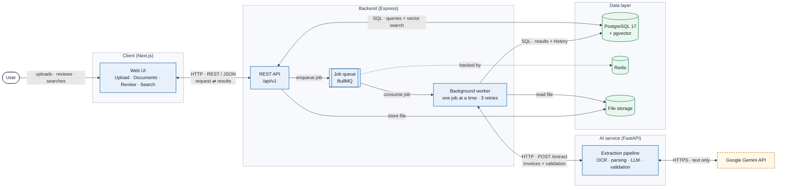
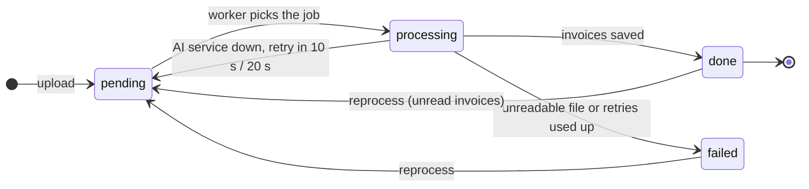

# Backend API and frontend

How the website and the REST API work together. Setup steps are in the [main README](../README.md).

## How a document moves through the system



*Blue: application services · Green: data stores · Dashed: external service.*

The website talks **only** to the backend. Only the AI service talks to Gemini and holds the API key.

## Backend API

Base URL: `http://localhost:3002`. Every answer has the same shape: `{ success, message, statusCode, data }`.

| Need from the brief | Method and path | What it does |
|---|---|---|
| Document upload | `POST /api/v1/documents` | Upload 1–20 files (field `files`, max 50 MB each). Answers at once; processing runs in the background |
| Processing status | `GET /api/v1/documents` | All documents with their status (`pending`, `processing`, `done`, `failed`). Filters: `status`, `needs_review`, `page`, `limit` |
| Extracted results | `GET /api/v1/documents/:id` | One document: its invoices (each field with status and evidence), line items, validation errors and history |
| Manual corrections | `PATCH /api/v1/invoices/:id` | `{ "fields": { "total": "1,150.00" } }` corrects a value; the invoice is checked again at once. `{ "reviewed": true }` marks it as checked |
| Failed-job reprocessing | `POST /api/v1/documents/:id/reprocess` | Processes a failed document again from the saved file |
| Document search | `GET /api/v1/search?q=acme` | Keyword search in invoice number, supplier, customer, file name, line items and text |
| | `GET /api/v1/search?q=office furniture&mode=meaning` | Semantic search (pgvector): finds "Office chairs" for "office furniture" |
| | Filters for both | `date_from`, `date_to`, `total_min`, `total_max`, `currency`, `supplier`, `needs_review` |
| Health check | `GET /health` | Shows that the API is running |

Example:

```bash
curl -F files=@invoice.pdf -F files=@prices.xlsx http://localhost:3002/api/v1/documents
curl http://localhost:3002/api/v1/documents/1
curl "http://localhost:3002/api/v1/search?q=acme&currency=USD&total_min=500"
```

### Background processing

Document status lifecycle:



- An upload only saves the file and puts a job in the queue (**Redis + BullMQ**), so the API never waits for OCR or AI.
- A worker processes the documents one at a time, so the free Gemini limit isn't used up in parallel.
- If the AI service can't be reached, the job is retried after 10 s and 20 s, then marked `failed` with the reason.
- After a server restart, unfinished documents are put back in the queue.
- Every step is saved in `processing_history` and shown on the website.

### Reliability and security

- **Uploads:** file type, count and size are checked. Files are saved under a random name, so a user's file name
  never becomes a path on the server.
- **Database:** all queries use parameters (no SQL built from user text). Money is stored as exact `numeric`.
- **CORS:** only the website's address may call the API (`CORS_ORIGINS`).
- **Errors:** a bad file or request gets a clear message and never crashes the server.
- **Secrets:** stored only in `.env` files, which are never committed.

## Frontend

Next.js 15, React 19, TypeScript, Tailwind CSS and shadcn/ui. Open `http://localhost:3000`.

| Page | Need from the brief | What the user can do |
|---|---|---|
| `/upload` | Upload multiple documents | Drag and drop up to 20 files; wrong files are refused before upload, with the reason |
| `/documents` | Monitor processing progress | See every document as Waiting, Processing, Done or Failed; updates by itself every 2 seconds |
| `/documents/[id]` | Inspect information, review errors, correct values | See each field with its status (found, uncertain, missing, corrected) and the **evidence** text it came from; see validation errors and line items; **Edit** a value, **Mark as checked**, or **Process again** a failed document |
| `/search` | Search processed documents | Keyword or meaning search with filters; the search is kept in the page address, so Back and bookmarks work |

**Rules the website follows**

- It shows money exactly as the backend sends it and never calculates with it.
- Text from documents is always shown as plain text, never as HTML (prevents script injection).
- Every error becomes a clear message on the screen, including "the backend can't be reached".
- A correction is cleaned and checked again by the backend, never decided by the website.

More detail: [`backend/README.md`](../backend/README.md) and [`client/README.md`](../client/README.md).
