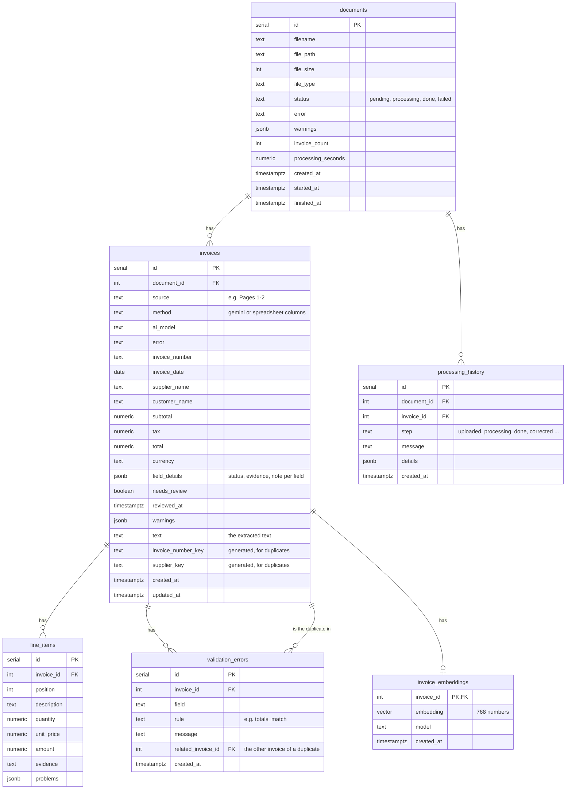

# Database schema

PostgreSQL 17 with the pgvector extension. The tables are defined in [`backend/database/schema.sql`](../backend/database/schema.sql)
and are created automatically when the backend starts.

| Table | What it holds |
|---|---|
| `documents` | One row per uploaded file (metadata), with its status: pending, processing, done or failed |
| `invoices` | One row per invoice found in a file: the values, each field's status and evidence, needs_review, and the **extracted text** |
| `line_items` | The lines of each invoice |
| `validation_errors` | The problems found by the checks (missing fields, totals, duplicates ...) |
| `processing_history` | What happened to a document and when (uploaded, done, corrected ...) |
| `invoice_embeddings` | The meaning of each invoice (768 numbers), for meaning search. In its own table so the API never sends these numbers to the website |

- Money is `numeric` (exact, never rounded like a float) and is sent as text, e.g. `"1150.00"`.
- Deleting a document also deletes everything that belongs to it (`ON DELETE CASCADE`).
- Indexes make the common look-ups fast: status, document, duplicates, needs review, and an **HNSW** index
  on the embeddings so finding the closest ones stays fast with many invoices.
