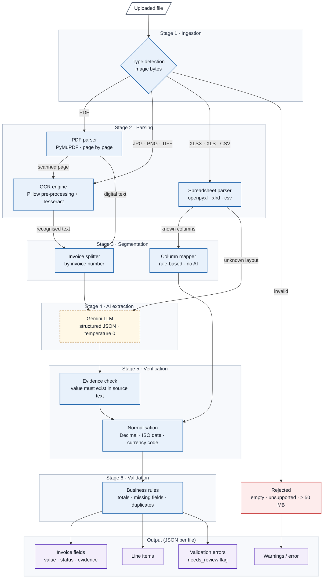

# Processing pipelines (PDF, image, Excel, CSV)

How the AI service (`AI/`) turns an uploaded file into checked invoice data.

## Overview



*Blue: processing steps · Dashed: external LLM · Purple: output · Red: rejected input.*

| Step | Code | What happens |
|---|---|---|
| 1. Detect the type | `file_type.py`, `process_file.py` | The real type is found from the file's first bytes, not its name. A renamed file is still read, with a warning. Empty, too-big (> 50 MB) and unsupported files get a clear error |
| 2. Read the file | `read_pdf.py`, `read_image.py`, `read_spreadsheet.py` | One reader per type (see below). All readers give the same result shape |
| 3. Find the invoices | `split_invoices.py`, `spreadsheet_invoices.py` | PDFs/images: pages are grouped by invoice number (one file can hold many invoices, one invoice can span pages). Spreadsheets: one row = one invoice |
| 4. Extract the fields | `extract_invoice.py`, `extract_prompt.txt` | Gemini reads the text of one invoice and returns JSON with a value **and evidence** for each field |
| 5. Check and clean | `extract_invoice.py`, `clean_values.py` | Evidence must be found in the document, or the field is marked *uncertain*. Dates, amounts (exact `Decimal`) and currencies are cleaned |
| 6. Validate | `validate_invoice.py` | Missing fields, wrong numbers, line items vs subtotal, subtotal + tax vs total, duplicates. Any problem marks the invoice *needs review* |

## PDF pipeline

**Library:** PyMuPDF. **File:** `read_pdf.py`.

1. The PDF is opened from memory and read **one page at a time**, so a 1000-page PDF uses little memory.
2. Each page is checked for text:
   - **Digital page** (at least 20 letters or digits): the text is taken directly, which is fast and exact.
   - **Scanned page** (almost no text): the page is rendered as a 300 DPI grayscale image and read with OCR
     (the image pipeline below). Mixed PDFs work: OCR is used only on the scanned pages.
3. Pages are grouped into invoices by their invoice number, and each invoice is sent to Gemini once.

| Problem | What happens |
|---|---|
| Damaged PDF | Error: "The PDF is damaged and can't be opened" |
| Password-protected PDF | Error: "The PDF is password-protected" |
| Blank page | Warning for that page; a fully blank document fails without using a Gemini request |
| One bad page | Warning for that page; the other pages are still read |

## Image pipeline (JPG, PNG, TIFF)

**Library:** Tesseract OCR (through pytesseract) and Pillow. **File:** `read_image.py`.

1. **Rotation from the phone:** the EXIF rotation saved by phone cameras is applied first.
2. **Clean-up for OCR**, in this order (the order was measured to give the best results):
   grayscale → enlarge small images to 1500 px wide → remove speckles → raise contrast of faded text → sharpen.
3. **OCR** with Tesseract, which also gives a confidence (0–100) for each word.
4. **Second tries for bad pages** (confidence below 60): the page is turned upright if it is sideways or upside
   down, and a stronger speckle filter is tried. The result Tesseract is most sure of is kept.
5. Every page of a multi-page TIFF is read.

| Problem | What happens |
|---|---|
| Poor quality (blurry, faded, small, noisy) | Cleaned before OCR; if confidence is still low, a warning is shown and uncertain values are sent to review |
| Rotated page or phone photo | Turned upright automatically |
| Damaged or huge image | Clear error message |

## Excel and CSV pipeline

**Libraries:** openpyxl (XLSX), xlrd (old XLS), Python `csv`. **Files:** `read_spreadsheet.py`, `spreadsheet_invoices.py`.

1. **Every sheet** is read. All cells are kept as **text**, so money is never turned into an inexact float.
   - XLSX: the saved result of each formula is used. A formula without a saved result is left empty (never
     calculated or guessed), with a warning.
   - XLS: dates stored as numbers are turned back into dates.
   - CSV: the separator (`,` `;` tab `|`) and the text encoding are detected automatically.
2. **Invoices are read from the columns without AI:** the header row is found (within the first 10 rows) and column
   names are matched to fields, e.g. "Inv No", "Bill number" → invoice number; "Vendor" → supplier;
   "Grand total" → total. Line items on another sheet are joined to their invoice by invoice number.
3. A sheet whose columns can't be matched is sent to Gemini as text, like a PDF.

This is fast (under 1 second per file in the evaluation), costs no Gemini requests, and is exact.

## Output

Every file gives the same JSON shape, even when it fails:

```json
{
  "filename": "invoice.pdf",
  "file_type": "pdf",
  "invoice_count": 1,
  "invoices": [
    {
      "source": "Pages 1-2",
      "method": "gemini",
      "ai_model": "gemini-3.5-flash",
      "fields": {
        "total": { "value": "1150.00", "status": "found", "evidence": "Total: $1,150.00", "note": null }
      },
      "line_items": [],
      "validation_errors": [],
      "needs_review": false
    }
  ],
  "warnings": [],
  "error": null
}
```

(Shortened: each invoice has all fields: invoice number, date, supplier, customer, subtotal, tax, total, currency.)

## Design choices

- **Text, not images, goes to Gemini:** OCR runs locally, so each invoice costs one small request on the free tier.
- **No value is invented:** a missing field is `null`; a value whose evidence isn't in the document is *uncertain*;
  both send the invoice to review.
- **One bad file, page or invoice never stops the rest.**

Measured results of these pipelines are in the [evaluation report](EVALUATION_REPORT.md).
